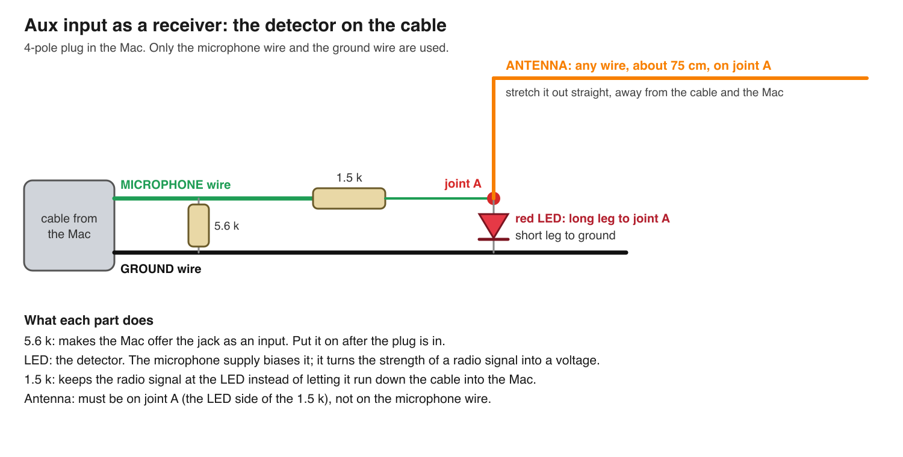
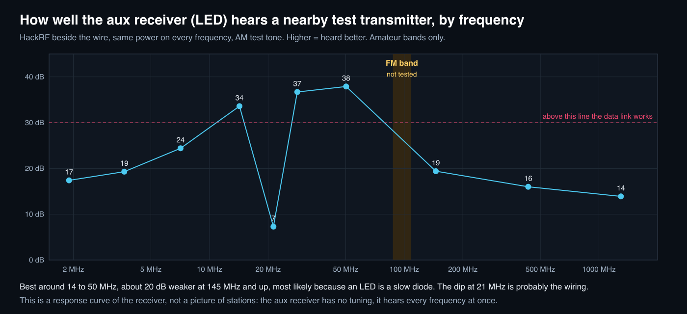

# The headphone jack as a receiver

Measured 2026-11-11 on a MacBook Pro (codec CS42L84) with a HackRF Pro as the test transmitter and as the reference receiver.
Everything here is one evening of bench work: it says what was measured, not what should work in general.

## Getting an input on the jack

- A 3-pole aux plug gives no input. The Mac only offers one when the plug has a microphone contact (4-pole plug).
- With a 4-pole cable cut open: put about **5.6 kOhm between the microphone wire and the ground wire, after the plug is in**.
  1.5 kOhm is logged by the codec as a fault and 4.5 kOhm was not accepted. Once the input shows it stays until the plug is pulled.
- `python3 -I jackrx.py auxwatch` prints what the codec decides while you try.
- The input is "External Microphone": 44.1, 48, 88.2 or 96 kHz, flat to about 40 kHz, falling off by 45 kHz.

## The detector



The sound input only hears up to about 45 kHz, so a radio signal has to be turned into audio on the cable. A red LED, biased by the
microphone supply, does that: it is a square-law detector, its output follows the *strength* of whatever radio signal is on the antenna
wire. Two things mattered:

- the antenna has to be on the LED side of the 1.5 kOhm resistor. On the microphone wire it does almost nothing;
- the detector has no tuning. It hears every frequency at once, so there is no spectrum to sweep and no way to pick a station.

## What it receives



- **A nearby AM transmitter, about 2 MHz to 1.3 GHz.** A HackRF beside the antenna wire, sending an AM test tone (6666.67 Hz, chosen
  to miss the mains harmonics), is received. It is radio and not noise through the USB cable: switching the HackRF's output amplifier,
  which changes only the radio power, moved the tone from +11..18 dB to +35 dB over the noise in 1 Hz.
- Response at the same transmit setting, dB over the noise in 1 Hz: 1.9 MHz 17, 3.65 MHz 19, 7.1 MHz 24, 14.25 MHz 34, 21.3 MHz 7,
  28.2 MHz 32-38, 50.3 MHz 36-38, 145.3 MHz 19, 433.3 MHz 16, 1296 MHz 14. The numbers move by several dB with how the wires lie.
- **Plain AM voice is not audible.** At that level speech sits about 12 dB under the noise. It can be found by correlation (57 times
  the noise level) but not heard. Averaging 16 repeats did not help.
- **Data gets through cleanly.** See the link below: 100 bit/s with every bit right.

## What it does not receive

- **Broadcast FM, or any distant station.** The recording of the jack's input was compared with seven local FM stations demodulated by
  the HackRF at the same moment (`lab/xcorr.swift`). All matches were at chance level, at the desk and outdoors (where the HackRF saw
  the stations about 14 dB stronger). The check itself works: a station hidden 50 dB under the noise is found. Reasons: FM has no
  loudness changes for a strength detector to follow, the stations are weak, and an LED is a slow diode (about 20 dB less output at
  145 MHz than at 50 MHz).
- **The jack's own radio lines as a tuning signal.** A carrier 10 kHz from one of the jack's lines produced no beat: the line is far
  too weak at the LED.
- **VLF stations (12-30 kHz)**, which could enter the sound input directly: 19 known transmitters checked, none seen with this
  short wire and low input impedance.
- A line near 19 kHz in the recordings is not a stereo pilot: it is the 19th harmonic of a 1000.5 Hz comb from the computer.

What would be needed for FM: a tuned circuit in front of the detector (to turn frequency swings into strength swings) and far more
signal at the diode than a wire gives, in practice an amplifying part. Not built.

## The link: data over the detector

`auxlink.swift` carries a frame as 16-tone FSK. From the HackRF the tones are the envelope of an AM carrier; the LED recovers them.

- Frame: pilot tone, 64-symbol preamble, length header, payload + CRC32 through a K=7 rate-1/2 convolutional code and an interleaver,
  64-symbol postamble (it measures the clock difference between the two ends). Soft-decision Viterbi decoding, per-tone noise estimates.
- Over the air on 28.234 MHz: **1659 bytes (9.5 s of speech in Codec 2 at 1300 bit/s) in 138 s, checksum correct**, at about
  30 dB-Hz with 6 % of the raw symbols wrong before correction. The decoded clip is [auxrx-voice-received.mp3](auxrx-voice-received.mp3).
- 20 ms symbols give 100 bit/s and need about 28 dB-Hz. 5 ms symbols (400 bit/s) need about 40 dB-Hz: not reached on this bench.

```bash
python3 -I jackrx.py auxlink --text "hello"        # the HackRF sends, the jack's input receives and decodes
python3 -I jackrx.py auxlink --file small.bin      # a file instead (65535 bytes at most; 100 bit/s is slow)
python3 -I jackrx.py auxlink --wav voice.wav       # a sound as plain AM: writes what was received, cleaned, to aux-received.wav
python3 -I jackrx.py auxlink --no-tx --text x      # only listen and decode (someone else transmits)
```

Options: `--freq MHZ` (default 28.234), `--gain 0..47` (default 30), `--amp 0|1` (default 1), `--t 5|10|20|40` (ms per symbol).
The HackRF's antenna has to be right beside the detector's antenna wire. **Transmit only on frequencies and at powers you are
allowed to use.** The test above used amateur bands with the transmitter beside the receiver.

The other direction, `jackrx.py jacklink`, plays the same frame out of the jack and receives it with the HackRF beside one of the
jack's radio lines. It decodes in simulation. It has **not** been run over the air: with a short cut-open cable the jack's lines are
almost gone (the long aux cable was their antenna), so it needs a long wire on the headphone contacts first.

## Live view

`python3 -I jackrx.py auxview` opens a page with the live spectrum and waterfall of the jack's input (0 to half the sample rate).
What shows there without any transmitter: mains hum at the low end, bumps near 8, 16 and 24 kHz and a comb of fine lines every
1000.5 Hz, all from the computer itself.

## Tools

- `jackrx.py aux`, `auxwatch`, `auxloop`, `auxview`, `auxlink`, `jacklink`
- `auxin.swift` (record), `auxspec.swift` (live spectra), `auxam.swift` (clean a recording for listening), `auxlink.swift` (the link)
- `lab/xcorr.swift` (is this programme inside that recording?), `lab/tone.py` (strength of one tone), `lab/chansim.swift` and
  `lab/jacksim.swift` (simulate each direction with recorded noise)

The built-in microphone is never opened by any of these.
